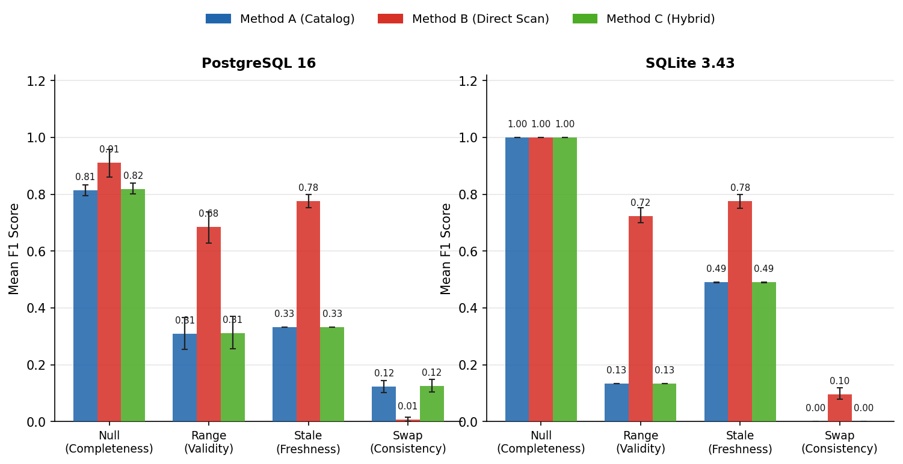
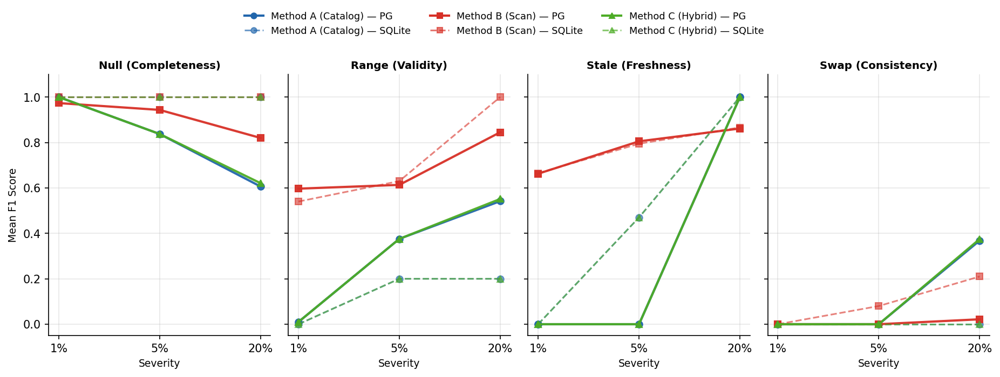
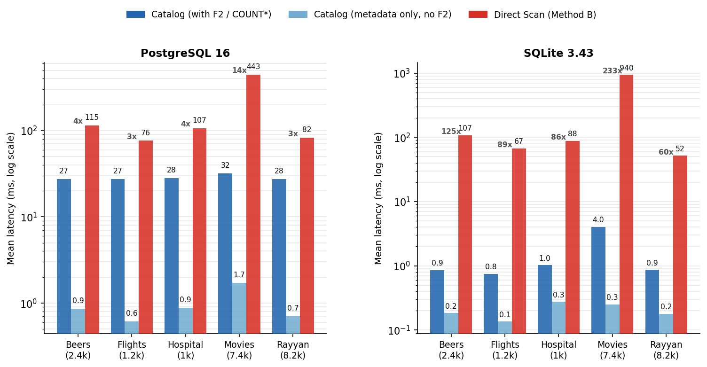
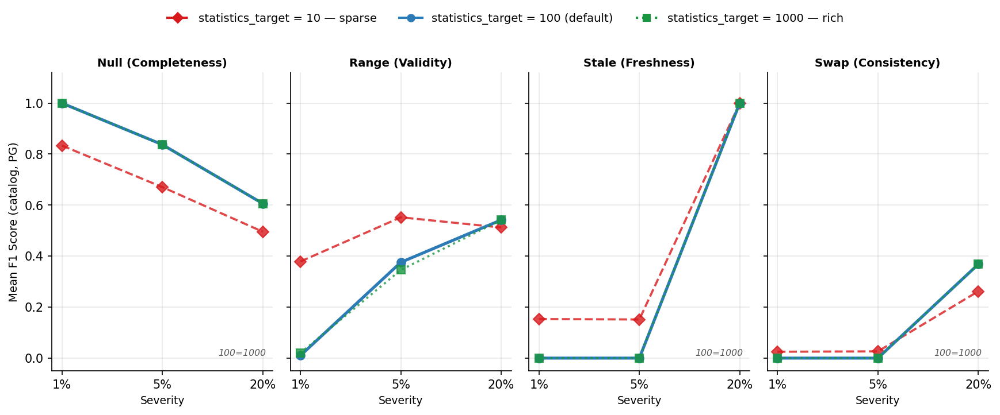

# catalog-dq

Metadata-only data quality detection: can the statistics an RDBMS already keeps for its query planner (null fractions, distinct counts, histograms, correlation) catch data-quality faults *without ever scanning the table*?

14,400 controlled experiments — 5 real datasets × 4 fault types × 3 severities × 3 methods (catalog / full-scan / hybrid) × 20 seeded repetitions — on PostgreSQL 16 and SQLite, run on a self-deployed and self-administered server. Full recipe to reproduce every number below in ~2–3 hours: see [Reproduce](#reproduce).

## Results

- **Headline surprise:** on swap faults at 20% severity, the catalog method *beats* full table scans — F1 0.883 vs 0.108 on the flights dataset — because PostgreSQL's correlation statistic sees positional disorder that value-range checks are blind to.
- **Honest failure:** richer statistics can make detection *worse*. PostgreSQL's K2 correlation rule fires false positives after heavy null injection, dragging F1 from 1.0 down to 0.26; SQLite's cruder catalog stays perfect at 1.0. More signal, more noise.
- **Freshness is a step function:** drift detection misses 1% and 5% row drift entirely, then hits 1.000 at 20% drift — on all five datasets. Thresholds create cliffs, not slopes.
- **Speed:** 3–14× faster than scanning in PostgreSQL, 61–233× faster in SQLite. 92–96% of the remaining catalog-side cost is a single `COUNT(*)`; pure metadata reads run sub-2ms.
- **Negative result:** `statistics_target` 100 vs 1000 gives identical F1 to three decimals — richer histograms buy nothing at default thresholds. The Postgres default is already Pareto-optimal here.

Baseline comparison: published scan-based DQ tools (e.g. Deequ) average 47% precision / 36% recall on real datasets — this is still an open problem, not a solved one.

## Figures

| | |
|---|---|
|  |  |
| **Fig 1.** F1 per fault type, per method | **Fig 2.** F1 vs. injected fault severity |
|  |  |
| **Fig 3.** Response time, catalog vs. scan (log-log) | **Fig 4.** F1 sensitivity to `statistics_target` |

## How it works

Seven detection rules read only catalog/planner statistics — no table scan:

| Rule | Reads | Catches |
|---|---|---|
| C1 | row count (`reltuples` / catalog count) | volume drift |
| V1, V2 | null fraction, distinct count | missing-value and cardinality faults |
| K1 | histogram / value-range stats | out-of-range / value faults |
| K2 | correlation statistic | positional / ordering (swap) faults |
| F1, F2 | staleness of planner stats vs. wall-clock | freshness / drift faults |

`hybrid.py` combines catalog signals with a fallback scan only when the catalog signal is ambiguous. Full rule logic: [`catalog_dq/rules.py`](catalog_dq/rules.py).

## Repo layout

```
catalog-dq/
├── docker-compose.yml          # PostgreSQL 16 for local runs
├── POSTGRES_RUN_GUIDE.md       # local (non-server) setup notes
├── requirements.txt
├── run_experiments.py          # CLI entry point — one run = one (dataset, fault, severity, method) cell
├── smoke_test.py                # end-to-end sanity check, expect F1=1.000 on the toy dataset
├── test_fixes.py                 # regression tests for 3 historical harness bugs (expect 8/8)
├── catalog_dq/
│   ├── baseline.py              # full-scan comparison method
│   ├── calibrate.py             # threshold calibration
│   ├── detector.py              # rule evaluation
│   ├── harness.py / harness_pg.py   # experiment orchestration (generic / Postgres-specific)
│   ├── hybrid.py                 # catalog+scan fallback method
│   ├── injector.py               # controlled fault injection
│   ├── rules.py                  # the seven catalog-only rules (C1, V1, V2, K1, K2, F1, F2)
│   ├── snapshot.py               # catalog-state capture
│   └── readers/                  # pg_reader.py, sqlite_reader.py
├── figures/                      # the four result figures (see above)
└── results/                      # results_summary.csv + results_quality.csv per backend + sensitivity sweeps
```

## Reproduce

Full step-by-step (exact commands, every failure mode we hit, and its fix) is in [`SERVER_RUN_GUIDE.md`](SERVER_RUN_GUIDE.md). Short version:

```bash
# fresh Ubuntu 20.04+, 4 vCPU / 8 GB is enough
sudo apt update && sudo apt install -y python3-venv python3-pip postgresql-16
sudo -u postgres psql -c "CREATE USER catalogdq WITH PASSWORD 'catalogdq';"
sudo -u postgres psql -c "CREATE DATABASE catalog_dq OWNER catalogdq;"

python3 -m venv .venv && source .venv/bin/activate
pip install -r requirements.txt

# check chain — never skip
python -m compileall -q catalog_dq run_experiments.py smoke_test.py test_fixes.py
python test_fixes.py        # expect 8/8
python smoke_test.py        # expect PASSED, F1=1.000

# trial (10-15 min) before committing to the full run
python run_experiments.py --db postgres --dsn "host=localhost port=5432 dbname=catalog_dq user=catalogdq password=catalogdq" \
  --dataset-dir datasets --datasets hospital flights beers rayyan movies_1 \
  --reps 2 --K 5 --z 2.0 --out-dir results_trial

# full run (~2-3h): same command with --reps 20, then repeat for --db sqlite
# and again with --statistics-target 10 / --statistics-target 1000 for the sensitivity sweep
```

Datasets (`hospital`, `flights`, `beers`, `rayyan`, `movies_1`, `toy`) are the standard data-cleaning benchmark set from [BigDaMa/raha](https://github.com/BigDaMa/raha) — each needs a `clean.csv` and `dirty.csv` under `datasets/<name>/`.

Expected shape on completion: `results_summary.csv` = 181 rows (180 cells + header), `results_quality.csv` = 3,601 rows, `n_errors` column all zero across every output.

## Notes on rigor

Three harness bugs were found and fixed by disciplined trial runs before they could poison any data: a type-blind fault injector, a `reltuples=-1` baseline artifact, and asymmetric timing windows between catalog and scan measurements. All three are documented in `test_fixes.py`.
